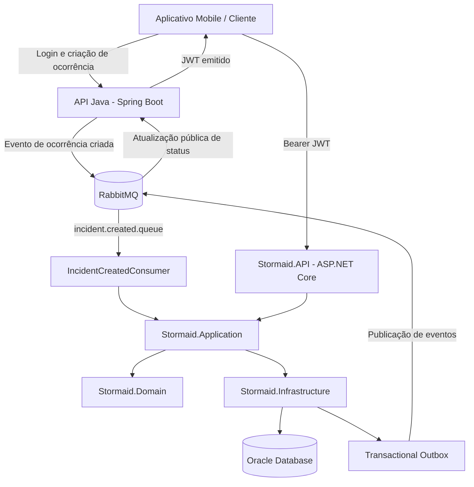
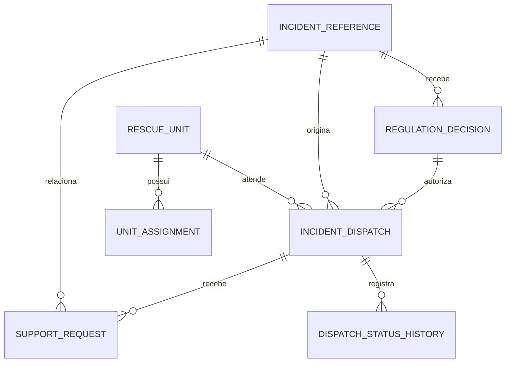

<!--
LOGO DO STORM AID
Quando a arte estiver pronta, salve-a em docs/logo-stormaid.png e remova este comentário:

<p align="center">
  
</p>
-->

# 🚨 Storm Aid API - Módulo de Regulação e Resgate

API REST desenvolvida em **ASP.NET Core / .NET 10** para o módulo institucional da plataforma **Storm Aid**, projeto da **Global Solution FIAP 2026/2**.

A solução busca conectar cidadãos em situações de emergência a serviços responsáveis pela **regulação de ocorrências e execução de resgates**, especialmente em cenários de alagamentos, deslizamentos, tempestades, acidentes e outras situações de risco.

A API .NET é responsável pela **gestão das ocorrências recebidas da API Java, regulação institucional, unidades de resgate, decisões e despachos operacionais**, com persistência em **Oracle Database**, **Entity Framework Core**, autenticação **JWT** compartilhada com o backend Java e comunicação assíncrona por **RabbitMQ e padrão Transactional Outbox**.

---

## 📑 Índice

- [👥 Integrantes](#-integrantes)
- [📚 Sobre o Projeto](#-sobre-o-projeto)
- [🎯 Problema e Público Beneficiado](#-problema-e-público-beneficiado)
- [🏗️ Arquitetura](#️-arquitetura)
- [🧭 Diagrama de Arquitetura](#-diagrama-de-arquitetura)
- [📁 Estrutura da Solução](#-estrutura-da-solução)
- [🚀 Tecnologias Utilizadas](#-tecnologias-utilizadas)
- [📦 Entidades](#-entidades)
- [🔁 Relacionamentos](#-relacionamentos)
- [🔐 Autenticação e Autorização](#-autenticação-e-autorização)
- [☕ Integração com a API Java](#-integração-com-a-api-java)
- [🐇 RabbitMQ e Transactional Outbox](#-rabbitmq-e-transactional-outbox)
- [📡 Endpoints](#-endpoints)
- [🔄 Fluxos e Estados](#-fluxos-e-estados)
- [📄 HTTP Status Codes](#-http-status-codes)
- [🛡️ Rate Limiting e Segurança](#️-rate-limiting-e-segurança)
- [🔗 HATEOAS](#-hateoas)
- [📘 Swagger / OpenAPI](#-swagger--openapi)
- [🩺 Health Checks](#-health-checks)
- [📝 Logs com Serilog](#-logs-com-serilog)
- [📊 Observabilidade com OpenTelemetry e Prometheus](#-observabilidade-com-opentelemetry-e-prometheus)
- [🗄️ Banco de Dados e Migrations](#️-banco-de-dados-e-migrations)
- [⚙️ Como Executar](#️-como-executar)
- [🧪 Testes](#-testes)
- [📈 Cobertura de Testes](#-cobertura-de-testes)
- [🐳 Docker](#-docker)
- [📌 Funcionalidades Implementadas](#-funcionalidades-implementadas)
- [🌐 Ambiente Publicado](#-ambiente-publicado)
- [⚠️ Limitações e Pendências](#️-limitações-e-pendências)

---

## 👥 Integrantes

<table>
  <tr>
    <td width="130"></td>
    <td><b>Moisés Barsoti Andrade de Oliveira</b><br /><b>RM:</b> 565049 &nbsp;|&nbsp; <b>Turma:</b> 2TDSPO - FIAP</td>
  </tr>
  <tr>
    <td width="130"></td>
    <td><b>Sofia Siqueira Fontes</b><br /><b>RM:</b> 563829 &nbsp;|&nbsp; <b>Turma:</b> 2TDSPG - FIAP</td>
  </tr>
  <tr>
    <td width="130"></td>
    <td><b>Manuela de Lacerda Soares</b><br /><b>RM:</b> 564887 &nbsp;|&nbsp; <b>Turma:</b> 2TDSPG - FIAP</td>
  </tr>
</table>

---

## 📚 Sobre o Projeto

O **Storm Aid** é uma plataforma de apoio à resposta a emergências que pretende reduzir a distância entre o pedido de ajuda de um cidadão e a atuação da instituição responsável.

O projeto contempla uma arquitetura dividida entre **API Java**, **API .NET** e **aplicativo Mobile**. Cada módulo possui responsabilidades próprias:

| Módulo | Responsabilidade |
| --- | --- |
| **Java / Spring Boot** | Identidade dos usuários, autenticação, emissão de JWT, registro das ocorrências e estados públicos do cidadão |
| **.NET / ASP.NET Core** | Fila de regulação, decisões institucionais, unidades de resgate, despachos e acompanhamento institucional das ocorrências |
| **React Native / Mobile** | Interface de acesso às funcionalidades do cidadão e consumo das APIs, conforme a evolução do aplicativo |
| **Oracle Database** | Persistência dos dados institucionais e operacionais do backend .NET |
| **RabbitMQ** | Transporte assíncrono dos eventos entre os backends Java e .NET |

### Responsabilidades implementadas na API .NET

- Receber e persistir referências de ocorrências enviadas pelo backend Java por evento assíncrono;
- Consultar e filtrar a fila de ocorrências institucionais;
- Iniciar a análise de uma ocorrência por um regulador;
- Registrar decisões regulatórias com justificativa;
- Cadastrar e consultar unidades de resgate;
- Criar despachos após a aprovação institucional;
- Permitir que a equipe responsável aceite, inicie o deslocamento, registre a chegada e conclua um despacho;
- Registrar o histórico de transições operacionais;
- Manter mensagens de atualização pública em uma Outbox persistida no Oracle;
- Disponibilizar ao cidadão autenticado o acompanhamento institucional **apenas de suas próprias ocorrências**;
- Aplicar autenticação, autorização por perfis e limitação de requisições;
- Disponibilizar documentação OpenAPI, Health Checks e logs estruturados;
- Executar testes automatizados das regras e dos endpoints.

---

## 🎯 Problema e Público Beneficiado

Em situações de emergência, especialmente durante eventos climáticos severos, cidadãos podem enfrentar dificuldades para comunicar o problema, informar a localização e acompanhar o andamento do atendimento.

A proposta do Storm Aid considera pessoas expostas a riscos como **alagamentos, deslizamentos, tempestades, incêndios e emergências médicas**, com atenção especial a **idosos, pessoas com deficiência, pessoas com mobilidade reduzida e moradores de áreas vulneráveis**.

A solução prevê diferentes canais de solicitação, representados no contrato da ocorrência:

| Canal | Enum | Significado |
| --- | --- | --- |
| SOS silencioso | `SOS_SILENT` | Solicitação sem necessidade de comunicação verbal |
| Entrada de texto | `TEXT_INPUT` | Relato preenchido por texto |
| Áudio/voz | `VOICE_AUDIO` | Solicitação originada por áudio ou voz |

Os dados recebidos também indicam se o atendimento é solicitado para o próprio usuário (`SELF`), um dependente (`DEPENDENT`) ou outra pessoa (`THIRD_PARTY`).

> A existência dos tipos de canal no contrato **não significa que a API .NET implemente reconhecimento de voz ou a interface SOS**. Seu papel é receber e processar os dados da ocorrência produzidos por outros módulos.

---

## 🏗️ Arquitetura

A solução .NET foi organizada com base em princípios de **Clean Architecture**, separando contratos HTTP, regras de aplicação, modelo de domínio e tecnologias de infraestrutura.

### Responsabilidades das camadas

```text
Stormaid.API
→ Minimal API / Endpoint Route Handlers
→ Controllers (agrupadores de rotas)
→ Configurations (JWT, OpenAPI, Rate Limiting, Health Checks e ObservabilityConfiguration)
→ Hateoas (HateoasLink, HateoasResource e IncidentDispatchHateoasLinks)
→ Messaging (consumidor RabbitMQ e publicador da Outbox)
→ Health
→ Program.cs

Stormaid.Application
→ DTOs de requisição, resposta e integração
→ Interfaces de repositórios e publicação de eventos
→ Services (casos de uso)
→ Exceções de aplicação

Stormaid.Domain
→ Entities
→ Enums
→ Regras de negócio e transições de estado

Stormaid.Infrastructure
→ StormaidDbContext
→ Mapeamentos Entity Framework Core
→ Repositories
→ OracleTransactionExecutor
→ RabbitMqOutboxPublisher
→ IntegrationEventOutbox
→ Migrations

Testes
→ Stormaid.Domain.Tests (NUnit)
→ tests/Stormaid.API.IntegrationTests (xUnit)
```

A camada `Domain` não depende da infraestrutura. As operações de aplicação utilizam contratos de repositório; as implementações e conexões externas ficam em `Infrastructure`.

Também são utilizados **injeção de dependência**, serviços de aplicação, repositórios, controle de concorrência, idempotência e transações para operações que atualizam múltiplas entidades.

---

## 🧭 Diagrama de Arquitetura



**Fluxo principal:** o Java registra a solicitação do cidadão e publica o evento; o .NET recebe a referência, realiza a regulação e o despacho; as alterações de status destinadas ao Java são persistidas na Outbox e publicadas pelo RabbitMQ quando o publicador está habilitado.

**Observação de ambiente:** a comunicação RabbitMQ do diagrama representa a arquitetura implementada e validada **localmente**. No Render, a API .NET está publicada com consumo e publicação de eventos desabilitados até a configuração de um broker acessível ao ambiente hospedado.

---

## 📁 Estrutura da Solução

```text
Stormaid/
├── Dockerfile
├── .dockerignore
├── .gitignore
├── Stormaid.sln
│
├── Stormaid.API/
│   ├── Configurations/
│   │   ├── HealthCheckConfiguration.cs
│   │   ├── JwtConfiguration.cs
│   │   ├── ObservabilityConfiguration.cs
│   │   ├── OpenApiConfiguration.cs
│   │   └── RateLimitingConfiguration.cs
│   ├── Controllers/
│   │   ├── CitizenIncidentTrackingController.cs
│   │   ├── IncidentDispatchController.cs
│   │   ├── RegulationController.cs
│   │   └── RescueUnitController.cs
│   ├── Health/
│   ├── Hateoas/
│   │   ├── HateoasLink.cs
│   │   ├── HateoasResource.cs
│   │   └── IncidentDispatchHateoasLinks.cs
│   ├── Messaging/
│   │   ├── IncidentCreatedConsumer.cs
│   │   └── OutboxPublisherBackgroundService.cs
│   ├── Properties/launchSettings.json
│   ├── appsettings.json
│   ├── appsettings.Development.json
│   ├── Program.cs
│   └── Stormaid.API.csproj
│
├── Stormaid.Application/
│   ├── DTOs/
│   │   ├── Integration/
│   │   ├── Request/
│   │   └── Response/
│   ├── Exceptions/
│   ├── Interfaces/
│   ├── Services/
│   └── Stormaid.Application.csproj
│
├── Stormaid.Domain/
│   ├── Common/
│   ├── Entities/
│   ├── Enums/
│   └── Stormaid.Domain.csproj
│
├── Stormaid.Infrastructure/
│   ├── Configurations/
│   ├── Data/
│   │   ├── Entities/
│   │   ├── Migrations/
│   │   └── StormaidDbContext.cs
│   ├── Messaging/
│   ├── Repositories/
│   ├── Transactions/
│   ├── DependencyInjection.cs
│   └── Stormaid.Infrastructure.csproj
│
├── Stormaid.Domain.Tests/
│   └── Entities/
│
└── tests/
    └── Stormaid.API.IntegrationTests/
        ├── Database/
        ├── Endpoints/
        ├── Factories/
        ├── Helpers/
        ├── Messaging/
        └── Services/
```

---

## 🚀 Tecnologias Utilizadas

| Tecnologia | Aplicação no projeto |
| --- | --- |
| **.NET 10 / C#** | Plataforma e linguagem do backend institucional |
| **ASP.NET Core Minimal API** | Exposição das rotas REST |
| **Entity Framework Core** | Mapeamento e persistência das entidades |
| **Oracle Database / Oracle.EntityFrameworkCore** | Banco relacional e provedor EF Core |
| **JWT Bearer (HS256)** | Validação local dos tokens emitidos pelo Java |
| **RabbitMQ.Client 7** | Consumo e publicação de eventos assíncronos |
| **Transactional Outbox** | Persistência dos eventos antes da publicação |
| **OpenAPI 3.1 / NSwag Swagger UI** | Especificação e documentação interativa |
| **Serilog** | Logs estruturados de aplicação e requisições |
| **OpenTelemetry** | Traces de requisições ASP.NET Core e chamadas HTTP, métricas HTTP e exportação OTLP opcional de traces |
| **Prometheus Exporter** | Métricas no endpoint `/metrics` habilitado apenas no ambiente Development |
| **HATEOAS** | Links de navegação opcionais nas respostas de unidades e despachos |
| **Health Checks** | Monitoramento da aplicação e conectividade Oracle |
| **Rate Limiting** | Proteção das rotas contra excesso de requisições |
| **NUnit** | Testes de entidades de domínio |
| **xUnit / Moq / WebApplicationFactory** | Testes de serviços e integração HTTP |
| **Coverlet Collector** | Coleta de cobertura de testes |
| **Docker** | Imagem de execução do backend |
| **Render** | Hospedagem da API .NET |

O projeto utiliza práticas como **Repository Pattern**, **Service Layer**, **injeção de dependência**, **validação de regras de domínio** e **controle de concorrência**.

---

## 📦 Entidades

O `StormaidDbContext` mapeia **10 conjuntos de dados**, sendo nove entidades do domínio e uma entidade de persistência da Outbox.

### IncidentReference

Representa a referência institucional de uma ocorrência criada na API Java. Preserva o `JavaIncidentId`, o identificador do solicitante, a categoria da emergência, o canal, a localização, o estado de regulação e a versão pública de sincronização.

### RegulationDecision

Registra a decisão tomada pelo regulador, incluindo o tipo da decisão, instituição responsável quando aplicável, justificativa, autor e data.

### RescueUnit

Representa uma unidade institucional de resgate, com código, nome, instituição, capacidade, acessibilidade de transporte, disponibilidade e situação operacional.

### UnitAssignment

Representa o vínculo operacional de um socorrista com uma unidade de resgate, com informações sobre quem realizou a vinculação e o período de atuação.

### IncidentDispatch

Representa o despacho de uma unidade de resgate para uma ocorrência aprovada pela regulação. Armazena a unidade responsável, o status, as datas operacionais e dados de auditoria.

### DispatchStatusHistory

Mantém o histórico das mudanças de status de um despacho, indicando estado anterior, estado novo, responsável e momento da transição.

### SupportRequest

Representa uma solicitação de apoio institucional relacionada a uma ocorrência e a um despacho. **Está modelada no domínio e no Oracle, mas o ZIP analisado não expõe endpoints HTTP próprios para gerenciá-la.**

### IdempotencyRecord

Representa registros utilizados para controlar repetição de operações e respostas associadas a uma chave de idempotência.

### ProcessedIntegrationEvent

Representa o registro de eventos processados, utilizado para auxiliar no controle de mensagens de integração.

### OutboxMessage

Entidade de infraestrutura utilizada para persistir eventos que aguardam publicação no RabbitMQ, incluindo tipo, identificador do evento, routing key, payload, tentativas e data de publicação.

---

## 🔁 Relacionamentos



O Oracle também mantém entidades técnicas independentes para **idempotência**, **controle de eventos processados** e **Outbox**.

A identificação dos cidadãos e profissionais tem origem no backend Java, sendo referenciada no .NET por identificadores presentes nos eventos e nas claims do JWT.

---

## 🔐 Autenticação e Autorização

A **API Java** autentica os usuários e emite os JWTs. A **API .NET não implementa um endpoint próprio de login**: ela recebe e valida os tokens emitidos pelo Java.

### Fluxo de autenticação

```text
Usuário / Cliente
      ↓ Realiza login
API Java / Autenticação
      ↓ Emite JWT
Usuário / Cliente
      ↓ Authorization: Bearer <TOKEN>
Stormaid.API (.NET)
      ↓ Valida assinatura, issuer, audience, expiração e perfil
Endpoint autorizado
```

### Contrato JWT utilizado pelo .NET

| Propriedade | Valor ou comportamento esperado |
| --- | --- |
| Assinatura | `HS256` |
| `iss` | `stormaid-api` |
| `aud` | `stormaid-services` |
| `sub` | Identidade do usuário autenticado |
| `userId` | Identificador numérico do usuário |
| `roles` | Perfil de acesso do usuário |
| Expiração | Token válido e não expirado |
| Segredo | Chave compartilhada com o Java, com pelo menos 32 bytes |
| Tolerância de relógio | 30 segundos |

A API .NET utiliza a configuração `Jwt:Secret` para verificar a assinatura do token. O segredo deve ser compatível com o utilizado pela API Java e **nunca deve ser publicado no Git**.

### Perfis de acesso

| Perfil | Permissões no módulo .NET |
| --- | --- |
| `CITIZEN` | Consulta de acompanhamento das próprias ocorrências |
| `REGULATOR` | Consultas de regulação, decisões, cadastro de unidades e criação de despachos |
| `RESPONDER` | Consulta de unidades e execução das transições do despacho atribuído à equipe |

A autorização é aplicada por grupos de rotas e operações específicas. A política `InstitutionalAccess` permite acesso institucional aos perfis `REGULATOR` e `RESPONDER`; determinadas operações exigem um perfil específico adicional.

### Proteção dos dados do cidadão

Em `GET /api/v1/citizens/incidents/{javaIncidentId}/tracking`, o serviço compara `RequesterUserId` da ocorrência com a claim `userId` do cidadão autenticado.

- Sem autenticação: `401 Unauthorized`;
- Perfil sem permissão: `403 Forbidden`;
- Ocorrência inexistente ou pertencente a outro cidadão: `404 Not Found`;
- Ocorrência pertencente ao usuário: `200 OK`.

O retorno `404` para uma ocorrência de outro cidadão impede que essa rota revele a existência de registros de terceiros.

---

## ☕ Integração com a API Java

A divisão entre os serviços evita duplicar responsabilidades: o Java controla a identidade e a ocorrência original; o .NET cuida da regulação e da operação institucional.

### Responsabilidades da API Java

- Cadastro e autenticação de usuários;
- Emissão dos tokens JWT;
- Registro das solicitações de socorro;
- Manutenção do estado público das ocorrências;
- Publicação de eventos de novas ocorrências;
- Consumo das atualizações de status emitidas pelo .NET.

### Responsabilidades da API .NET

- Validar os JWTs emitidos pelo Java;
- Receber referências de ocorrências pelo RabbitMQ;
- Persistir os dados operacionais no Oracle;
- Executar regulação, decisões e despachos;
- Registrar as atualizações de status na Outbox;
- Publicar atualizações destinadas ao Java quando o publicador estiver habilitado;
- Consultar o estado institucional de ocorrências pertencentes ao cidadão autenticado.

### Exemplo de requisição autenticada

```http
GET /api/v1/citizens/incidents/307/tracking HTTP/1.1
Authorization: Bearer <JWT_DO_CIDADAO>
```

Exemplo de resposta validada nos testes de integração entre os serviços:

```json
{
  "javaIncidentId": 307,
  "regulationStatus": "CLOSED",
  "publicStatusVersion": 7
}
```

**Atenção:** `CLOSED` é o estado interno de regulação no .NET. Quando um despacho é concluído, o evento público enviado ao Java utiliza `RESOLVED`. Os estados internos e públicos não devem ser confundidos.

### Teste de integração Java → .NET via JWT

1. Inicie a API Java e autentique um usuário cadastrado;
2. Copie o JWT emitido pelo Java;
3. Acesse o Swagger da API .NET;
4. Clique em **Authorize** e informe o token;
5. Utilize uma rota compatível com o perfil autenticado;
6. Confirme os códigos HTTP e as regras de acesso.

> O endpoint e o payload de login devem ser consultados na documentação da API Java. Não existe rota de login no serviço .NET deste repositório.

---

## 🐇 RabbitMQ e Transactional Outbox

A comunicação assíncrona entre Java e .NET utiliza o **RabbitMQ**. O backend .NET possui um consumidor de eventos de ocorrência criada e um publicador dos eventos de atualização de status.

### Entrada: ocorrências criadas pelo Java

| Configuração | Valor padrão |
| --- | --- |
| Fila de consumo | `incident.created.queue` |
| Consumidor | `IncidentCreatedConsumer` |
| Serviço de aplicação | `IncidentCreatedEventService` |
| Habilitação | `RabbitMQ:Enabled` |

O evento de entrada utiliza o contrato `IncidentCreatedEvent`, que contém `incidentId`, `requesterUserId`, `recipientType`, `channelType`, `emergencyCategory`, informações opcionais de localização e data de criação.

Exemplo **ilustrativo do contrato de entrada**:

```json
{
  "incidentId": 307,
  "requesterUserId": 903,
  "recipientType": "SELF",
  "channelType": "TEXT_INPUT",
  "emergencyCategory": "CLIMATE_DISASTER",
  "location": {
    "source": "GPS",
    "latitude": -23.5505,
    "longitude": -46.6333,
    "addressText": "Endereço de exemplo",
    "referencePoint": "Próximo à praça",
    "accuracyMeters": 15
  },
  "createdAt": "2026-11-15T20:00:00Z"
}
```

O consumidor realiza desserialização, validação, persistência e confirmação manual da entrega. Há **até três tentativas de processamento**; mensagens inválidas ou com falha persistente são rejeitadas para o tratamento configurado no broker. O consumidor espera que a fila já exista.

### Saída: atualização pública de status

| Configuração | Valor |
| --- | --- |
| Tipo de evento | `incident.status.changed.v1` |
| Routing key | `incident.status.changed.v1` |
| Exchange padrão | `stormaid.events` |
| Entidade persistida | `OutboxMessage` |
| Serviço em segundo plano | `OutboxPublisherBackgroundService` |
| Habilitação | `OutboxPublisher:Enabled` |

Exemplo **ilustrativo do contrato de saída**:

```json
{
  "eventType": "incident.status.changed.v1",
  "eventId": "evt-dispatch-307-7",
  "incidentId": 307,
  "status": "RESOLVED",
  "version": 7,
  "changedAt": "2026-11-15T20:00:00Z"
}
```

### Funcionamento da Outbox

1. Uma operação institucional modifica os dados no Oracle;
2. Na mesma unidade transacional, o serviço grava a mensagem de integração na Outbox;
3. O publicador consulta periodicamente as mensagens ainda não publicadas;
4. A publicação é realizada no exchange RabbitMQ, utilizando mensagens persistentes e confirmações do broker;
5. Após o envio, o publicador marca a mensagem como publicada no Oracle;
6. Em caso de falha, registra a tentativa para uma nova execução.

O serviço de publicação consulta lotes de até **10 mensagens** em intervalos de aproximadamente **10 segundos**.

O padrão reduz o risco de perder eventos caso a alteração no banco seja concluída e a comunicação com o RabbitMQ falhe. A entrega deve ser tratada como **potencialmente repetida**, razão pela qual são importantes a idempotência e o versionamento dos eventos.

### Estado da integração

| Ambiente | Situação |
| --- | --- |
| **Laboratório RabbitMQ isolado** | Publicador real do .NET e comportamento de ACK/NACK/DLQ testados no broker local, sem Oracle |
| **Consumidor de status Java (testes automatizados)** | Casos de `CANCELLED` e versionamento aprovados com dependências simuladas |
| **Fluxo ponta a ponta Java → RabbitMQ → .NET → Java** | Não comprovado integralmente nesta rodada de testes |
| **Render (API .NET via HTTP)** | Deploy bem-sucedido e aplicação Live, conforme painel de 16/11/2026 |
| **Render (RabbitMQ / Outbox em funcionamento contínuo)** | Não foi demonstrado como habilitado e validado |

No Render, as configurações utilizadas na validação HTTP foram `RabbitMQ__Enabled=false` e `OutboxPublisher__Enabled=false`. Para habilitar a mensageria em produção será necessário provisionar um broker acessível, filas, exchange, bindings e credenciais seguras.

---

## 📡 Endpoints

**Base URL local:** `http://localhost:5283`  
**Base URL publicada:** `https://stormaid-dotnet-gs.onrender.com`

A API utiliza prefixo `/api/v1` para os recursos de negócio.

### Regulação de Ocorrências

| Método | Endpoint | Descrição | Acesso |
| --- | --- | --- | --- |
| `GET` | `/api/v1/regulation/incidents` | Listar ocorrências com filtro e paginação | `REGULATOR` |
| `GET` | `/api/v1/regulation/incidents/{javaIncidentId}` | Consultar referência da ocorrência pelo ID Java | `REGULATOR` |
| `POST` | `/api/v1/regulation/incidents/{javaIncidentId}/review` | Iniciar análise institucional | `REGULATOR` |
| `POST` | `/api/v1/regulation/incidents/{javaIncidentId}/decisions` | Registrar decisão regulatória | `REGULATOR` |

**Filtros de `GET /api/v1/regulation/incidents`:**

| Parâmetro | Descrição | Padrão |
| --- | --- | --- |
| `status` | Estado de regulação, opcional | Todos |
| `page` | Página iniciada em zero | `0` |
| `size` | Quantidade por página, entre 1 e 100 | `10` |

Exemplo:

```http
GET /api/v1/regulation/incidents?status=PENDING_REVIEW&page=0&size=10
```

**Exemplo de decisão aprovada:**

```http
POST /api/v1/regulation/incidents/307/decisions
Authorization: Bearer <JWT_REGULATOR>
Content-Type: application/json
```

```json
{
  "decisionType": "DISPATCH_APPROVED",
  "institutionType": "FIRE_DEPARTMENT",
  "justification": "Ocorrência analisada e despacho da equipe aprovado."
}
```

Tipos de decisão reconhecidos:

- `DISPATCH_APPROVED`;
- `MORE_INFORMATION_REQUIRED`;
- `NO_DISPATCH_REQUIRED`.

Quando `decisionType` é `DISPATCH_APPROVED`, `institutionType` é obrigatório. Nos demais tipos de decisão, deve ser `null`. A justificativa deve conter de **10 a 1000 caracteres**.

### Unidades de Resgate

| Método | Endpoint | Descrição | Acesso |
| --- | --- | --- | --- |
| `GET` | `/api/v1/rescue-units` | Listar unidades com paginação | `REGULATOR` ou `RESPONDER` |
| `GET` | `/api/v1/rescue-units/{id}` | Consultar unidade por ID | `REGULATOR` ou `RESPONDER` |
| `POST` | `/api/v1/rescue-units` | Cadastrar unidade de resgate | `REGULATOR` |

A listagem utiliza `page=1` e `pageSize=10` por padrão, com `pageSize` entre 1 e 100.

```http
GET /api/v1/rescue-units?page=1&pageSize=10
```

**Exemplo de cadastro:**

```json
{
  "unitCode": "UR-001",
  "displayName": "Unidade de Resgate 01",
  "institutionType": "FIRE_DEPARTMENT",
  "capacity": 4,
  "supportsAccessibleTransport": true
}
```

Instituições reconhecidas: `FIRE_DEPARTMENT`, `EMERGENCY_MEDICAL_SERVICE`, `MILITARY_POLICE` e `CIVIL_DEFENSE`.

> Os códigos e IDs acima são exemplos de formato, não uma garantia de que os registros existam no banco utilizado durante a avaliação.

### Despachos Operacionais

| Método | Endpoint | Descrição | Acesso |
| --- | --- | --- | --- |
| `POST` | `/api/v1/dispatches` | Criar despacho após aprovação da regulação | `REGULATOR` |
| `POST` | `/api/v1/dispatches/{id}/accept` | Aceitar despacho atribuído | `RESPONDER` |
| `POST` | `/api/v1/dispatches/{id}/start-route` | Registrar início do deslocamento | `RESPONDER` |
| `POST` | `/api/v1/dispatches/{id}/arrive` | Registrar chegada ao local | `RESPONDER` |
| `POST` | `/api/v1/dispatches/{id}/resolve` | Concluir atendimento | `RESPONDER` |
| `POST` | `/api/v1/dispatches/{id}/cancel` | Cancelar despacho com justificativa | `REGULATOR` |

**Exemplo de criação de despacho:**

```http
POST /api/v1/dispatches
Authorization: Bearer <JWT_REGULATOR>
Content-Type: application/json
```

```json
{
  "javaIncidentId": 307,
  "rescueUnitId": 13,
  "notes": "Equipe designada para atendimento da ocorrência."
}
```

As transições dependem do estado atual do despacho e da identidade do socorrista. Operações incompatíveis podem retornar `409 Conflict`.

**Cancelamento de despacho (implementado):**

```http
POST /api/v1/dispatches/13/cancel
Authorization: Bearer <JWT_REGULATOR>
Content-Type: application/json
```

```json
{
  "reason": "Cancelamento institucional devido à mudança das condições de atendimento."
}
```

O regulador pode cancelar um despacho em `PENDING_ACCEPTANCE`, `ACCEPTED`, `EN_ROUTE` ou `ON_SITE`. O serviço registra `CANCELLED`, encerra a regulação da ocorrência, libera a unidade se estiver ativa e ocupada, registra o histórico e cria um evento `incident.status.changed.v1` na Outbox, tudo dentro da operação transacional. Despachos `RESOLVED` não podem ser cancelados (`409`); um despacho já `CANCELLED` retorna seu estado existente. A justificativa precisa ter de 1 a 500 caracteres.

### Acompanhamento do Cidadão

| Método | Endpoint | Descrição | Acesso |
| --- | --- | --- | --- |
| `GET` | `/api/v1/citizens/incidents/{javaIncidentId}/tracking` | Consultar o estado institucional de ocorrência própria | `CITIZEN`, com validação de titularidade |

Resposta de exemplo:

```json
{
  "javaIncidentId": 307,
  "regulationStatus": "CLOSED",
  "publicStatusVersion": 7
}
```

A rota não permite que um cidadão consulte uma ocorrência de outro usuário.

### Rotas Públicas e Monitoramento

| Método | Endpoint | Descrição |
| --- | --- | --- |
| `GET` | `/` | Identificação da API, documentação, Health Checks e referências de rotas |
| `GET` | `/health` | Estado geral dos Health Checks |
| `GET` | `/health/live` | Liveness da aplicação |
| `GET` | `/health/ready` | Conectividade Oracle |
| `GET` | `/openapi/v1.json` | Documento OpenAPI, quando habilitado |
| `GET` | `/swagger/index.html` | Interface Swagger, quando habilitada |

> Os endpoints de Health Checks e a raiz são rotas de infraestrutura; não fazem parte das 14 operações de negócio descritas acima.

---

## 🔄 Fluxos e Estados

### Estados da ocorrência na regulação (.NET)

```text
PENDING_REVIEW
      ↓ Início da análise
UNDER_REVIEW
      ├── MORE_INFORMATION_REQUIRED → permanece UNDER_REVIEW
      ├── NO_DISPATCH_REQUIRED ────→ CLOSED
      └── DISPATCH_APPROVED ───────→ AWAITING_DISPATCH
                                         ↓ Criação do despacho
                                      DISPATCHED
                                         ↓ Conclusão
                                       CLOSED
```

### Estados do despacho operacional

```text
PENDING_ACCEPTANCE
      ↓ accept
ACCEPTED
      ↓ start-route
EN_ROUTE
      ↓ arrive
ON_SITE
      ↓ resolve
RESOLVED
```

O despacho também pode transicionar para `CANCELLED` por `POST /api/v1/dispatches/{id}/cancel`, se ainda não estiver concluído. Essa operação é exclusiva do perfil `REGULATOR` e emite o evento público `CANCELLED` pela Outbox.

### Atualização do estado público no Java

Quando uma transição exige comunicação com o Java, o .NET registra um evento `incident.status.changed.v1`, com `incidentId`, `status`, `version` e `changedAt`. A versão pública cresce a cada atualização relevante para evitar aplicação de eventos obsoletos.

---

## 📄 HTTP Status Codes

| Código | Significado no Storm Aid |
| --- | --- |
| `200 OK` | Consulta ou operação concluída |
| `201 Created` | Recurso criado, como unidade, decisão ou despacho |
| `400 Bad Request` | Parâmetros, identificadores ou dados inválidos |
| `401 Unauthorized` | JWT ausente, inválido ou expirado |
| `403 Forbidden` | Perfil ou identidade sem permissão |
| `404 Not Found` | Recurso inexistente ou ocorrência de outro cidadão na rota de acompanhamento |
| `409 Conflict` | Conflito de concorrência, duplicidade ou transição de estado inválida |
| `429 Too Many Requests` | Limite de requisições excedido |
| `500 Internal Server Error` | Erro interno não tratado |
| `503 Service Unavailable` | Health Check de prontidão sem disponibilidade de dependência |

A API utiliza respostas do tipo **Problem Details** nas validações de erro documentadas pelos endpoints.

Exemplo ilustrativo:

```json
{
  "type": "about:blank",
  "title": "Identificador inválido.",
  "status": 400,
  "detail": "O identificador deve ser maior que zero."
}
```

---

## 🛡️ Rate Limiting e Segurança

A política `InstitutionalApi` é aplicada às rotas de negócio e utiliza um **Fixed Window Rate Limiter**:

- Até **10 requisições por janela de 30 segundos**;
- Particionamento pela claim `userId` quando disponível;
- Fallback por endereço IP quando não há `userId`;
- Sem fila de espera (`QueueLimit = 0`);
- Excesso de requisições: HTTP `429` e resposta Problem Details;
- Cabeçalho `Retry-After` quando o tempo de espera puder ser informado.

Além da limitação de tráfego, são aplicadas validações de identidade JWT, perfil, titularidade das ocorrências, IDs positivos e transições permitidas pelo domínio.

---

## 🔗 HATEOAS

A API possui suporte **opcional** a HATEOAS para permitir que o cliente descubra links relacionados ao recurso retornado. A implementação utiliza `HateoasLink` (`rel`, `href` e `method`), `HateoasResource<T>` (`data` e `links`) e `IncidentDispatchHateoasLinks`.

A navegação é habilitada exclusivamente por `?includeLinks=true` nas operações implementadas:

| Método | Endpoint | Links retornados |
| --- | --- | --- |
| `GET` | `/api/v1/rescue-units/{id}?includeLinks=true` | `self` e `collection` |
| `POST` | `/api/v1/dispatches?includeLinks=true` | `rescue-unit` e, quando permitido, `cancel` |
| `POST` | `/api/v1/dispatches/{id}/cancel?includeLinks=true` | `rescue-unit`; não oferece novo cancelamento após `CANCELLED` |

O link `cancel` só aparece para usuário `REGULATOR` e despacho em estado cancelável (`PENDING_ACCEPTANCE`, `ACCEPTED`, `EN_ROUTE` ou `ON_SITE`). Sem `includeLinks=true` (ou usando `false`), o formato anterior das respostas é preservado.

Os testes automatizados cobrem os links oferecidos conforme perfil e estado, o formato legado e os códigos HTTP das respostas.

---

## 📘 Swagger / OpenAPI

A API utiliza a geração OpenAPI do **ASP.NET Core** (`MapOpenApi`) e a interface **NSwag Swagger UI**.

### Ambiente local

```text
http://localhost:5283/swagger/index.html
http://localhost:5283/openapi/v1.json
```

### Ambiente publicado

```text
https://stormaid-dotnet-gs.onrender.com/swagger/index.html
https://stormaid-dotnet-gs.onrender.com/openapi/v1.json
```

O Swagger apresenta:

- Título e descrição do Storm Aid;
- Rotas agrupadas por regulação, unidades de resgate, acompanhamento e despachos;
- Parâmetros, requisições, respostas e status HTTP;
- Esquema Bearer JWT e botão **Authorize**;
- Exemplos de estruturas definidos pelos contratos da API.

O OpenAPI é habilitado automaticamente no ambiente `Development`. Em `Production`, depende da configuração:

```text
OpenApi__Enabled=true
```

Essa configuração **disponibiliza publicamente a documentação**, mas **não desabilita a autenticação dos endpoints de negócio**.

---

## 🩺 Health Checks

| Endpoint | Verificação |
| --- | --- |
| `/health` | Estado agregado dos checks registrados |
| `/health/live` | Processo da aplicação ativo (`self`) |
| `/health/ready` | Conectividade com o Oracle via `StormaidDbContext` |

Exemplo de verificação:

```bash
curl -i http://localhost:5283/health/live
curl -i http://localhost:5283/health/ready
```

Resposta saudável de readiness, em formato simplificado:

```json
{
  "status": "Healthy",
  "totalDurationMs": 125.5,
  "checks": {
    "oracle": {
      "status": "Healthy",
      "durationMs": 123.91
    }
  }
}
```

Os valores de duração dependem de cada execução. Um problema de conectividade pode resultar em `503 Service Unavailable`.

> O Health Check de readiness confirma a disponibilidade do Oracle; não comprova que o broker RabbitMQ esteja ativo nem que os eventos estejam sendo transmitidos.

---

## 📝 Logs com Serilog

O Storm Aid utiliza **Serilog** integrado ao `ILogger<T>` do ASP.NET Core, com saída estruturada no console.

O middleware `UseSerilogRequestLogging()` registra:

- Método HTTP;
- Caminho solicitado;
- Status de resposta;
- Duração em milissegundos;
- Propriedades de contexto, como `RequestId`, quando disponíveis.

Exemplo:

```text
[2026-11-15 20:57:57.620 -03:00 INF] Serilog.AspNetCore.RequestLoggingMiddleware HTTP GET / respondeu 200 em 524.6978 ms {"RequestId": "0HNQ3EH2M5PRD:00000001"}
```

Os níveis definidos em `appsettings.json` incluem `Information`, `Warning` e `Error`, com redução da verbosidade dos namespaces `Microsoft` e `System`.

### Destino dos logs

O sink configurado é **`Serilog.Sinks.Console`**, permitindo acompanhar a execução pelo terminal ou pelo painel de logs do Render.

O Serilog continua responsável pelos logs estruturados no console. O projeto **também** implementa OpenTelemetry e Prometheus para observabilidade; esses componentes não substituem o Serilog.

---

## 📊 Observabilidade com OpenTelemetry e Prometheus

A classe `Stormaid.API/Configurations/ObservabilityConfiguration.cs` registra a instrumentação em `AddStormaidObservability()`, chamada pelo `Program.cs`.

| Recurso | Implementação |
| --- | --- |
| Identificação do serviço | Recurso OpenTelemetry com nome `Stormaid.API` |
| Tracing | Instrumentação ASP.NET Core e `HttpClient` |
| Métricas | Instrumentação ASP.NET Core e `HttpClient` |
| Exportador Prometheus | `AddPrometheusExporter()` |
| Exportação de traces por OTLP | **Opcional**, habilitada com `OpenTelemetry__ExportTracesToOtlp=true` |
| Endpoint de scraping | `GET /metrics`, **somente em `Development`** |

O tracing HTTP exclui `/metrics` para não produzir spans de scraping. O endpoint utiliza `DisableHttpMetrics()` e não exige JWT no ambiente de desenvolvimento.

Exemplo de consulta **local**, sem conectar ao Oracle:

```bash
curl -i http://localhost:5283/health/live
curl -i http://localhost:5283/metrics
```

Na validação local anterior, `/health/live` e `/metrics` responderam HTTP `200`; o endpoint de métricas retornou dados no formato Prometheus. Isso não comprova um coletor Prometheus externo nem exportação OTLP em execução.

**Render / Production:** o `Program.cs` não mapeia `/metrics` em `Production`; por isso não se deve anunciar esse endpoint como público na URL do Render. A exportação de traces OTLP também permanece desabilitada se a opção não for explicitamente configurada.

Credenciais, senhas e tokens JWT não devem ser incluídos nos registros de log.

---

## 🗄️ Banco de Dados e Migrations

A persistência institucional é realizada no **Oracle Database**, com `Oracle.EntityFrameworkCore` e `StormaidDbContext`.

### Tabelas gerenciadas pelo modelo .NET

| Entidade | Tabela Oracle |
| --- | --- |
| `IncidentReference` | `TB_STORMAID_INCIDENT_REFERENCE` |
| `RegulationDecision` | `TB_STORMAID_REGULATION_DECISION` |
| `RescueUnit` | `TB_STORMAID_RESCUE_UNIT` |
| `UnitAssignment` | `TB_STORMAID_UNIT_ASSIGNMENT` |
| `IncidentDispatch` | `TB_STORMAID_INCIDENT_DISPATCH` |
| `DispatchStatusHistory` | `TB_STORMAID_DISPATCH_HISTORY` |
| `SupportRequest` | `TB_STORMAID_SUPPORT_REQUEST` |
| `IdempotencyRecord` | `TB_STORMAID_IDEMPOTENCY` |
| `ProcessedIntegrationEvent` | `TB_STORMAID_PROCESSED_EVENT` |
| `OutboxMessage` | `TB_STORMAID_OUTBOX_MESSAGE` |

O schema utilizado na validação acadêmica foi `RM563829`. Os dados de conexão reais são fornecidos fora do repositório.

### Migration baseline

A versão analisada contém a migration:

```text
20261116000330_BaselineExistingOracleSchema
```

Arquivos:

```text
Stormaid.Infrastructure/Data/Migrations/
├── 20261116000330_BaselineExistingOracleSchema.cs
├── 20261116000330_BaselineExistingOracleSchema.Designer.cs
└── StormaidDbContextModelSnapshot.cs
```

A baseline possui métodos `Up()` e `Down()` **intencionalmente vazios**, pois as dez tabelas e os índices iniciais já haviam sido provisionados no Oracle pelos scripts SQL do projeto.

Isso evita a recriação das estruturas e a exclusão de dados durante o rollback da baseline.

### Histórico exclusivo de migrations

O .NET utiliza a tabela:

```text
TB_STORMAID_EF_MIGRATIONS
```

Configurada em `Stormaid.Infrastructure/DependencyInjection.cs`, por meio de `MigrationsHistoryTable()`.

A tabela exclusiva evita misturar o histórico do Storm Aid com a tabela padrão `__EFMigrationsHistory`, que já era utilizada por outros projetos no mesmo schema Oracle.

A baseline foi registrada no Oracle com a versão EF Core `10.0.14`:

```text
20261116000330_BaselineExistingOracleSchema | 10.0.14
```

### Comandos de consulta

Listar migrations:

```bash
dotnet ef migrations list \
  --project Stormaid.Infrastructure \
  --startup-project Stormaid.API \
  --context StormaidDbContext
```

Verificar mudanças no modelo:

```bash
dotnet ef migrations has-pending-model-changes \
  --project Stormaid.Infrastructure \
  --startup-project Stormaid.API \
  --context StormaidDbContext
```

Gerar SQL de inspeção, sem executá-lo:

```bash
dotnet ef migrations script 0 BaselineExistingOracleSchema \
  --project Stormaid.Infrastructure \
  --startup-project Stormaid.API \
  --context StormaidDbContext \
  --output /tmp/stormaid-baseline.sql
```

### Cuidados ao provisionar outro ambiente

1. Criar e validar o schema e as tabelas pelos **scripts SQL de provisionamento**;
2. Configurar `ConnectionStrings:Oracle` para o schema correto;
3. Verificar se o histórico exclusivo já contém a baseline;
4. Revisar o SQL gerado pelo EF antes de qualquer atualização;
5. Somente então registrar a baseline no novo schema, se for necessário.

> **Atenção:** **não** executar indiscriminadamente `dotnet ef database update` contra um banco vazio esperando que a baseline crie as tabelas de negócio; ela não faz isso.

---

## ⚙️ Como Executar

### Pré-requisitos

- SDK **.NET 10**;
- Acesso a um schema **Oracle** provisionado com as tabelas do Storm Aid;
- Segredo JWT compartilhado com a API Java, com pelo menos 32 bytes;
- Opcionalmente, **Docker**;
- Para integração por eventos, broker **RabbitMQ** com fila, exchange e bindings configurados;
- Ferramenta `dotnet-ef` para tarefas de migrations.

### 1. Clonar o repositório

```bash
git clone https://github.com/2026-2Semestre-Stormaid-Global-Solution/stormaid-dotnet-gs.git
cd stormaid-dotnet-gs
```

Os comandos seguintes são executados na pasta que contém o arquivo `Stormaid.sln`.

### 2. Restaurar dependências

```bash
dotnet restore Stormaid.sln
```

### 3. Configurar segredos locais

O projeto já possui `UserSecretsId`. Configure a conexão Oracle e a chave JWT no ambiente de desenvolvimento:

```bash
dotnet user-secrets set \
  "ConnectionStrings:Oracle" \
  "User Id=USUARIO;Password=SENHA;Data Source=HOST_ORACLE:1521/SERVICO;" \
  --project Stormaid.API/Stormaid.API.csproj
```

```bash
dotnet user-secrets set \
  "Jwt:Secret" \
  "SEGREDO_COMPARTILHADO_COM_O_JAVA_COM_PELO_MENOS_32_BYTES" \
  --project Stormaid.API/Stormaid.API.csproj
```

A sintaxe do `Data Source` depende da configuração do Oracle, incluindo o uso de **service name** ou **SID**. Utilize a string de conexão disponibilizada para o ambiente, sem presumir que os dois formatos sejam intercambiáveis.

### 4. Compilar

```bash
dotnet build Stormaid.sln
```

### 5. Executar a API

```bash
dotnet run \
  --project Stormaid.API/Stormaid.API.csproj \
  --launch-profile http
```

A API ficará disponível em:

```text
http://localhost:5283
```

Swagger:

```text
http://localhost:5283/swagger/index.html
```

### 6. Verificar a execução

```bash
curl -i http://localhost:5283/
curl -i http://localhost:5283/health/live
curl -i http://localhost:5283/health/ready
```

Uma conexão Oracle válida permite que `/health/ready` retorne `200 OK`.

### 7. Habilitar o RabbitMQ localmente (opcional)

Além de iniciar o broker, é necessário **provisionar a fila `incident.created.queue`, o exchange `stormaid.events` e os bindings esperados pela integração**. O consumidor do .NET utiliza uma declaração passiva e, portanto, não cria a fila automaticamente.

Variáveis de ambiente utilizadas:

```text
RabbitMQ__Enabled=true
RabbitMQ__HostName=localhost
RabbitMQ__Port=5672
RabbitMQ__VirtualHost=/
RabbitMQ__QueueName=incident.created.queue
RabbitMQ__StatusExchangeName=stormaid.events
RabbitMQ__UserName=USUARIO_RABBITMQ
RabbitMQ__Password=SENHA_RABBITMQ
RabbitMQ__UseTls=false
OutboxPublisher__Enabled=true
```

Use `false` para os dois flags quando desejar executar apenas os endpoints HTTP, sem broker configurado.

---

## 🧪 Testes

A solução utiliza dois projetos de testes:

```text
Stormaid.Domain.Tests/                 # NUnit
└── Entities/                          # Regras e estados de domínio

tests/Stormaid.API.IntegrationTests/   # xUnit
├── Database/                          # Cenários com Oracle (execução controlada)
├── Endpoints/                         # HTTP, JWT, rate limiting e health
├── Messaging/                         # Consumidor e testes do RabbitMQ
├── Services/                          # Serviços e fluxos de aplicação
├── Factories/                         # WebApplicationFactory e fakes
└── Helpers/                           # JWT de teste e utilitários
```

### Casos abordados

- Validações e transições das entidades de domínio;
- Criação e consulta de unidades de resgate;
- Fila de regulação, análise institucional e decisões;
- Criação, transições e **cancelamento institucional** dos despachos;
- Respostas HATEOAS opcionais em consulta de unidade, criação e cancelamento de despacho;
- Autenticação e autorização JWT;
- Restrição de acompanhamento à ocorrência do próprio cidadão;
- Rate Limiting e respostas HTTP;
- Health Checks;
- Consumo e tratamento de eventos de ocorrência criada;
- Publicação real com `RabbitMqOutboxPublisher`, incluindo confirmação de entrega e rejeição de mensagem sem rota;
- ACK, NACK com requeue e NACK com Dead Letter Queue no broker local isolado;
- Idempotência, controle de concorrência e cenários transacionais;
- Testes de rollback com Oracle, quando habilitados.

### Executar toda a suíte

```bash
dotnet test Stormaid.sln
```

### Resultados de testes registrados

**Execução integral anterior**, registrada antes dos últimos testes RabbitMQ adicionados:

```text
Total:        361
Aprovados:    353
Falhas:         0
Ignorados:      8
```

**Execuções isoladas realizadas posteriormente com RabbitMQ local real:**

| Classe | Cenários | Resultado |
| --- | --- | --- |
| `RabbitMqOutboxPublisherIntegrationTests` | Mensagem persistente entregue e rejeição de mensagem sem rota | **2 aprovados, 0 falhas** |
| `RabbitMqAckNackDlqIntegrationTests` | ACK, NACK com `requeue=true` e envio à DLQ com `requeue=false` | **3 aprovados, 0 falhas** |

Os cinco testes foram executados com `STORMAID_RUN_RABBITMQ_TESTS=1`, contra o broker Docker de laboratório (AMQP na porta local `5673`). Não instanciam o fluxo de persistência Oracle. Com essa variável ausente ou diferente de `1`, são ignorados.

As classes `IncidentDispatchCancelEndpointTests`, `IncidentDispatchHateoasEndpointTests` e `RescueUnitHateoasEndpointTests` verificam, respectivamente, autorização e respostas de cancelamento, links HATEOAS de despachos e navegação HATEOAS de unidades. Os testes HTTP usam dependências simuladas.

**Não há nesta documentação uma nova execução consolidada da suíte inteira após esses cinco testes**; portanto, a soma dos resultados isolados não é apresentada como nova contagem geral.

Os oito testes ignorados dependem de Oracle real e não são executados por padrão; nas classes correspondentes, é mencionada a variável:

```text
STORMAID_RUN_ORACLE_TESTS=1
```

> Execute testes que modificam dados ou validam transações **somente em um schema de testes isolado e com credenciais apropriadas**. Não habilite esses testes contra o banco compartilhado de produção ou avaliação sem revisar seu comportamento.

### Executar somente testes de mensageria no broker local

```bash
export STORMAID_RUN_RABBITMQ_TESTS=1
export STORMAID_RABBITMQ_USER="USUARIO_DO_BROKER_LOCAL"
export STORMAID_RABBITMQ_PASSWORD="SENHA_DO_BROKER_LOCAL"

dotnet test tests/Stormaid.API.IntegrationTests/Stormaid.API.IntegrationTests.csproj \
  --filter "FullyQualifiedName~RabbitMqOutboxPublisherIntegrationTests|FullyQualifiedName~RabbitMqAckNackDlqIntegrationTests"

unset STORMAID_RUN_RABBITMQ_TESTS
unset STORMAID_RABBITMQ_USER
unset STORMAID_RABBITMQ_PASSWORD
```

Esses testes exigem o broker de laboratório acessível em `127.0.0.1:5673` e não devem ser executados contra filas de produção. Os testes configuram exchanges e filas temporárias exclusivas para os cenários de confirmação, rejeição e dead lettering.

Os testes HTTP utilizam `WebApplicationFactory` e dependências substituídas para isolar cenários. Códigos `400`, `401`, `403`, `404`, `409` e `503` nos logs de execução desses cenários podem ser **resultados esperados dos testes**, e não falhas da suíte.

---

## 📈 Cobertura de Testes

O projeto inclui `coverlet.collector` nos projetos de teste. Para coletar cobertura:

```bash
dotnet test Stormaid.sln --collect:"XPlat Code Coverage"
```

Os relatórios são gerados sob diretórios `TestResults` dos projetos de testes, normalmente em formato **Cobertura XML**.

---

## 🐳 Docker

O repositório contém um **Dockerfile multi-stage** na raiz, com imagem de build `mcr.microsoft.com/dotnet/sdk:10.0` e imagem final `mcr.microsoft.com/dotnet/aspnet:10.0`.

### Construir a imagem

Na raiz da solução:

```bash
docker build -t stormaid-api:local .
```

### Executar a imagem

O container utiliza a porta interna **10000**. Crie um arquivo local `.env.docker` **fora do versionamento Git** com os valores reais do ambiente:

```dotenv
ConnectionStrings__Oracle=STRING_DE_CONEXAO_ORACLE
Jwt__Secret=SEGREDO_COMPARTILHADO_COM_O_JAVA
OpenApi__Enabled=true
RabbitMQ__Enabled=false
OutboxPublisher__Enabled=false
```

Depois:

```bash
docker run --rm \
  --name stormaid-api-local \
  -p 10000:10000 \
  --env-file .env.docker \
  stormaid-api:local
```

A API ficará disponível em:

```text
http://localhost:10000
http://localhost:10000/health/live
http://localhost:10000/health/ready
http://localhost:10000/swagger/index.html
```

---

## 📌 Funcionalidades Implementadas

- [x] API REST com ASP.NET Core Minimal API;
- [x] Clean Architecture em quatro projetos de produção;
- [x] Entidades e regras de domínio;
- [x] Oracle Database com Entity Framework Core;
- [x] Mapeamentos e repositórios;
- [x] Migration baseline vazia, snapshot e histórico exclusivo;
- [x] JWT emitido pelo Java e validado pelo .NET;
- [x] Permissões `CITIZEN`, `REGULATOR` e `RESPONDER`;
- [x] Validação de titularidade da ocorrência;
- [x] Listagem e consulta da regulação;
- [x] Início de análise e registro de decisões;
- [x] Cadastro e consulta de unidades de resgate;
- [x] Criação, evolução e cancelamento institucional de despachos operacionais;
- [x] HATEOAS opcional em consulta de unidade e operações de despachos;
- [x] Histórico de mudanças de status dos despachos;
- [x] Publicador .NET, roteamento, ACK/NACK e DLQ **validados isoladamente no RabbitMQ local**;
- [x] Controles de idempotência e concorrência;
- [x] Rate Limiting por usuário/IP;
- [x] OpenAPI e Swagger UI;
- [x] Health Checks de aplicação e Oracle;
- [x] Serilog com logs no console;
- [x] OpenTelemetry (traces e métricas) e exportação OTLP opcional de traces;
- [x] Prometheus exporter e `/metrics` em `Development`;
- [x] Testes automatizados de domínio, cancelamento, HATEOAS e integração RabbitMQ;
- [x] Dockerfile multi-stage;
- [x] Publicação HTTP da API no Render;

---

## 🌐 Ambiente Publicado

A API .NET do Storm Aid está publicada no **Render**.

| Recurso | URL |
| --- | --- |
| 🚀 **API .NET** | https://stormaid-dotnet-gs.onrender.com |
| 📘 **Swagger UI** | https://stormaid-dotnet-gs.onrender.com/swagger/index.html |
| 📄 **OpenAPI JSON** | https://stormaid-dotnet-gs.onrender.com/openapi/v1.json |
| 🩺 **Health Check geral** | https://stormaid-dotnet-gs.onrender.com/health |
| 💚 **Liveness** | https://stormaid-dotnet-gs.onrender.com/health/live |
| ✅ **Readiness Oracle** | https://stormaid-dotnet-gs.onrender.com/health/ready |
| 💻 **Repositório GitHub** | https://github.com/2026-2Semestre-Stormaid-Global-Solution/stormaid-dotnet-gs |

A publicação utiliza **Docker**, **ASP.NET Core em ambiente Production**, **Oracle** para persistência e **Serilog** para registros no console do serviço. O painel Render exibiu **Deploy succeeded | Live** para o commit `9b9696e` em 16/11/2026. Isso confirma o deploy, não a execução de fluxos de negócio com Oracle ou a mensageria ponta a ponta.

### Variáveis de ambiente principais do Render

```text
ConnectionStrings__Oracle
Jwt__Secret
OpenApi__Enabled=true
RabbitMQ__Enabled=false
OutboxPublisher__Enabled=false
```

O plano de hospedagem pode realizar suspensão por inatividade, afetando o tempo de resposta da primeira chamada. `/health/live` verifica o processo da API; `/health/ready` verifica o Oracle e deve ser usado apenas em ambiente apropriado, sem sobrecarregar o banco compartilhado.

---

## ⚠️ Limitações e Pendências

- Os testes isolados comprovam o publicador .NET e o comportamento do broker RabbitMQ; **não equivalem à comprovação do fluxo completo entre aplicações em produção**.
- Os testes que dependem de Oracle real permanecem desabilitados por padrão; não foram reexecutados nesta etapa.
- O endpoint `/metrics` é mapeado somente em `Development`. Não há evidência apresentada de scraping por servidor Prometheus externo ou de exportação OTLP ativa em produção.
- A mensageria RabbitMQ e a publicação contínua da Outbox não foram demonstradas em funcionamento no ambiente Render desta entrega.

